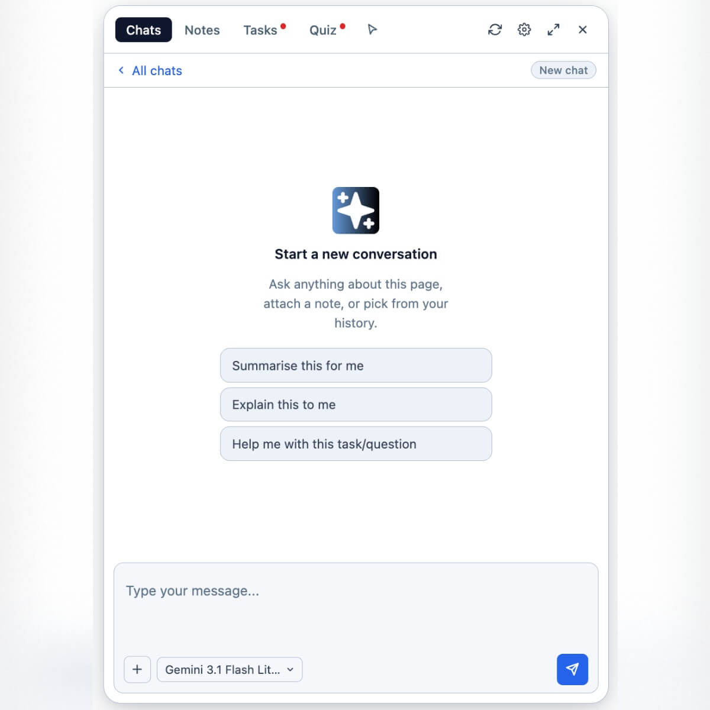
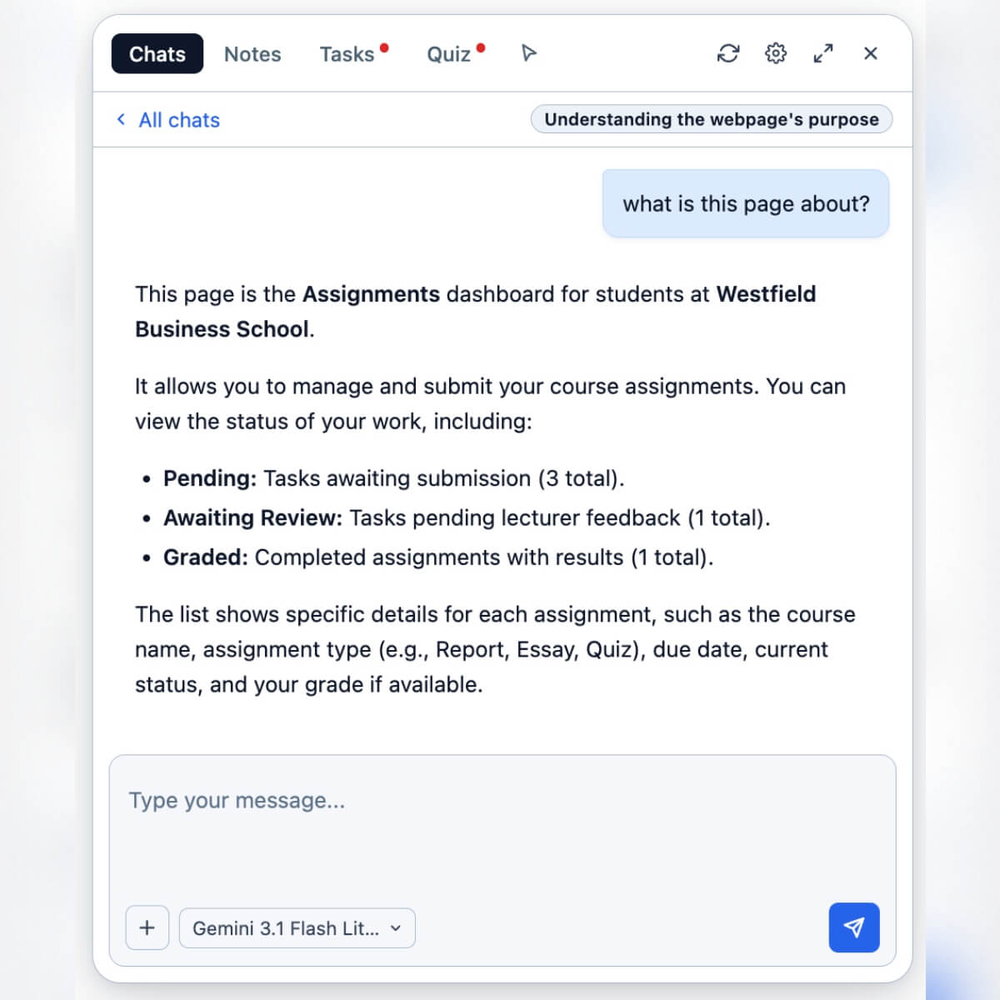
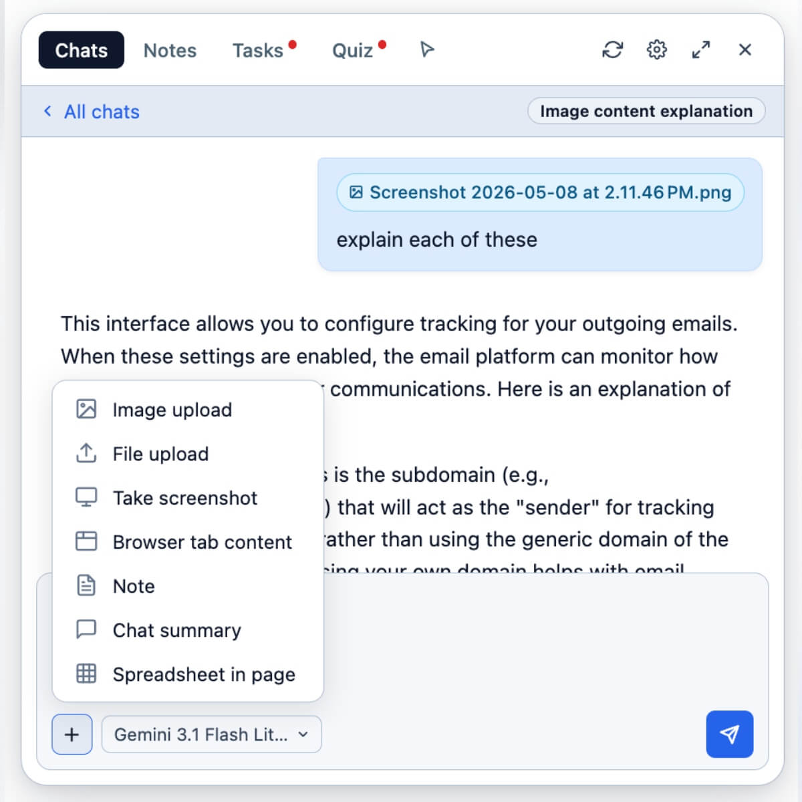
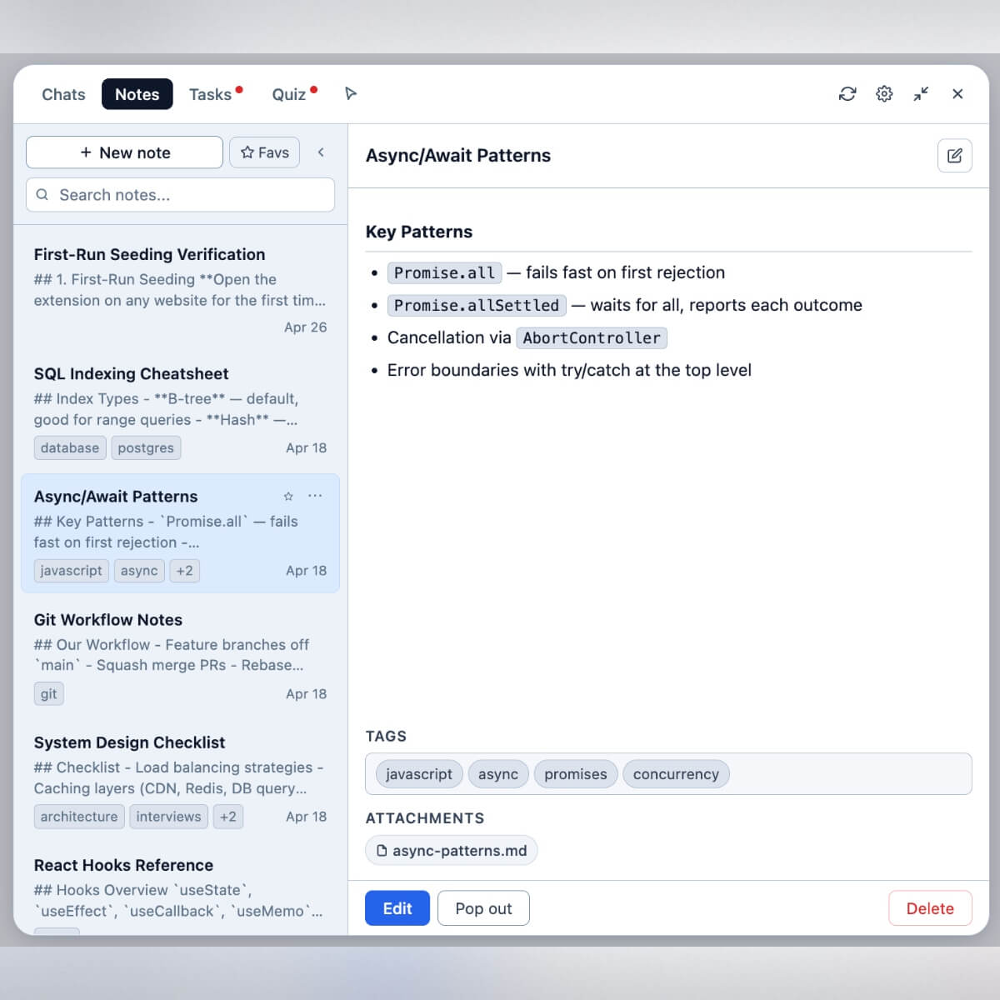
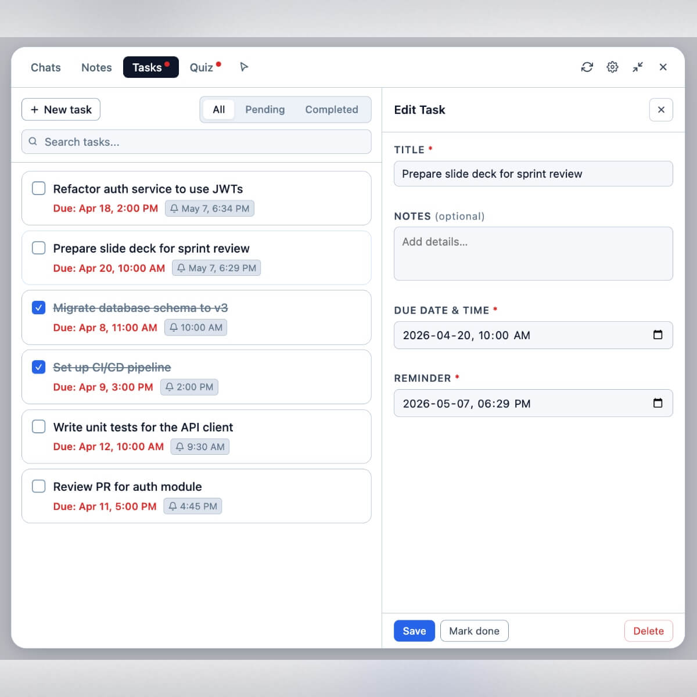
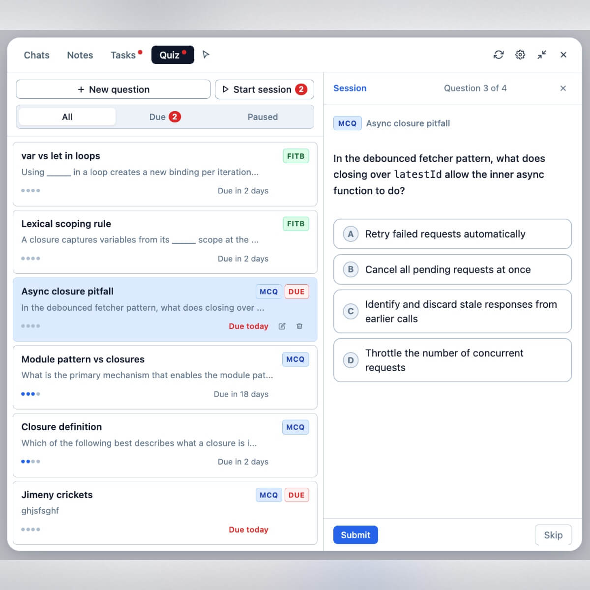
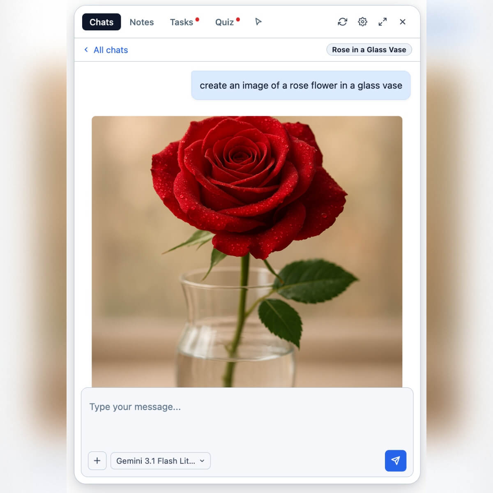
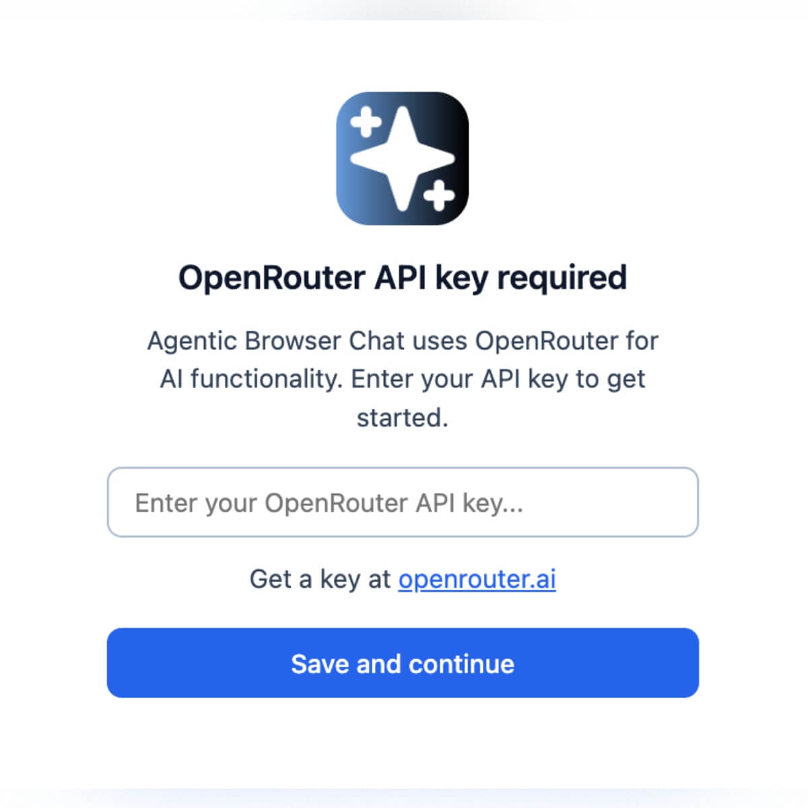
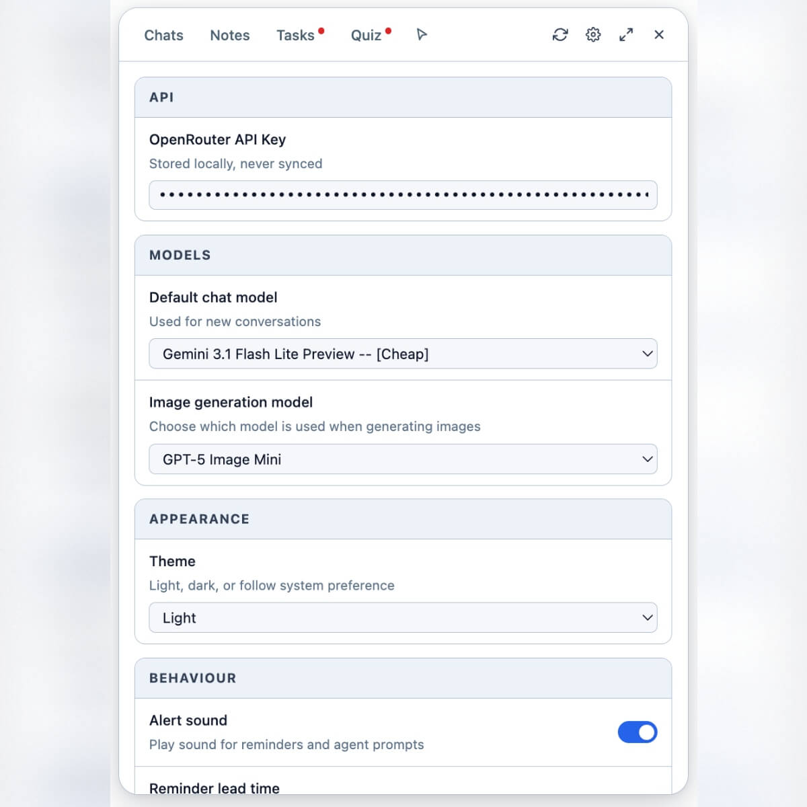

# Agentic Browser Chat

> A local-first AI assistant that lives in your browser tab. Chat with any page, run agent tools, and keep your notes, tasks, and memory on your device.

[](https://chromewebstore.google.com/detail/bmkiakodphbdicdfbajbcjemccacihcd)
[](./LICENSE)
[](https://developer.chrome.com/docs/extensions/mv3/intro/)
[](./CONTRIBUTING.md)

---

## Table of contents

- [What it is](#what-it-is)
- [Screenshots](#screenshots)
- [Features](#features)
  - [Chat with any page](#chat-with-any-page)
  - [Right-click menu and content selector](#right-click-menu-and-content-selector)
  - [Attachments](#attachments)
  - [Notes](#notes)
  - [Tasks](#tasks)
  - [Quiz](#quiz)
  - [Agent tools](#agent-tools)
  - [Memory, Skills, and Custom Instructions](#memory-skills-and-custom-instructions)
  - [API call logs](#api-call-logs)
  - [Cross-tab sync](#cross-tab-sync)
  - [Rendering](#rendering)
- [Install](#install)
- [Quick start](#quick-start)
- [Configuration](#configuration)
- [Permissions: what each one is for](#permissions-what-each-one-is-for)
- [Privacy](#privacy)
- [Architecture](#architecture)
- [Project layout](#project-layout)
- [Bundled libraries](#bundled-libraries)
- [Development](#development)
- [Troubleshooting](#troubleshooting)
- [Roadmap & status](#roadmap--status)
- [Contributing](#contributing)
- [Security](#security)
- [License](#license)
- [Acknowledgements](#acknowledgements)

---

## What it is

Agentic Browser Chat is a Chrome extension that puts an AI assistant into an overlay panel on every page you open. It reads the page you are on, answers questions about it, takes actions through a built-in set of agent tools, and keeps your notes, tasks, and quizzes alongside the chat.

Everything stays on your device. There is no backend, no analytics, and no developer-controlled server. The only network destination is OpenRouter, the single LLM provider this extension uses, and you authenticate with your own key.

What you can do with it:

- Read the current page and answer questions about it.
- Hold long-running conversations with searchable history, favorites, and per-chat model overrides.
- Take actions through a tool registry: page queries, form filling, code execution in a sandboxed worker, web search, web fetch, document and image generation, and more.
- Remember facts about you across chats, save reusable procedures as **skills**, and apply your own **custom instructions** to every chat.
- Manage notes (with version history and pop-out editor), tasks (with reminders), and quizzes, all from the same panel.
- Attach files (PDF, DOCX, PPTX, XLSX, CSV, images), browser tabs, other chats, other notes, screenshots, and pasted spreadsheets.

## Screenshots

<table>
  <tr>
    <td align="center"><br><sub><b>Chat</b> — start a conversation about the current page</sub></td>
    <td align="center"><br><sub><b>Page context</b> — ask anything about what's on screen</sub></td>
    <td align="center"><br><sub><b>Attachments</b> — PDF, DOCX, PPTX, XLSX, CSV, images</sub></td>
  </tr>
  <tr>
    <td align="center"><br><sub><b>Notes</b> — build a personal knowledge base</sub></td>
    <td align="center"><br><sub><b>Tasks</b> — with due dates and reminders</sub></td>
    <td align="center"><br><sub><b>Quizzes</b> — practice from your notes</sub></td>
  </tr>
  <tr>
    <td align="center"><br><sub><b>Image generation</b> — inline via your selected model</sub></td>
    <td align="center"><br><sub><b>Setup</b> — paste your OpenRouter key once</sub></td>
    <td align="center"><br><sub><b>Settings</b> — model, theme, data management</sub></td>
  </tr>
</table>

## Features

### Chat with any page

- Per-page chat with the LLM, with full markdown, code, diagram, and math rendering.
- Persistent chat history: searchable, sortable, pinnable. Old chats can be auto-pruned on a threshold you set.
- Suggested prompts on every new chat (*Summarise this for me*, *Explain this to me*, *Help me with this task/question*).
- Per-chat model override: pick any OpenRouter model for an individual conversation without changing your default.
- Favorites: pin the chats you keep coming back to, and switch to the Favs view to filter the list.
- Quick Question: a lightweight modal triggered from right-clicking a selection. Each Quick Question becomes its own short chat in a separate **Quick Q** log so it doesn't clutter your main history.
- Copy raw chat for export or sharing.
- Reduce-to-float / Expand panel modes: shrink the panel to a floating bubble, or expand it to take over the viewport.

### Right-click menu and content selector

- Right-click menu entries:
  - On a text selection: *Quick Question about selection*, *Add selection to chat*, *Save selection to clips*.
  - On an image: *Add image to chat*.
- Content selector: a hover-highlight mode you can toggle on. Click any page element to add its content to the chat. Right-clicking the highlight opens a small menu to choose **Add simple HTML to chat** (cleaned, flattened representation) or **Add raw HTML to chat** (the literal markup).
- Runs survive navigation: agent turns are hosted in an offscreen document, so an in-progress task keeps going across page reloads or navigations. The panel re-subscribes when it comes back.

### Attachments

Attach context to a chat via the **`+`** button in the input area:

| Source | Notes |
|---|---|
| **Image upload** | `.png`, `.jpg`, `.webp`, `.gif` |
| **File upload** | `.txt`, `.md`, `.json`, `.csv`, `.pdf`, `.docx`, `.xlsx`, `.xls`, `.ods`, `.pptx` (and other `text/*`) |
| **Take screenshot** | Snapshots the current tab and attaches the image inline |
| **Browser tab content** | Pick another open tab; its content gets flattened and attached |
| **Note** | Attach an existing note as context |
| **Chat summary** | Attach a summary of another chat |
| **Spreadsheet from clipboard** | Paste tabular data from your clipboard and treat it as a spreadsheet attachment |

Inside the **Notes** editor, you can also attach files to the note itself (the same file types as chat input).

### Notes

- A full note editor inside the panel with **Edit** mode and a separate **read view**.
- Pop-out: open any note in its own floating window so you can keep editing while you browse and chat in the main panel.
- Version history: changes are versioned so you can recover earlier drafts.
- Favorites and search.
- File attachments on each note.
- Skill notes: a note can be marked as a skill with a slug like `calculate-worksheet-discrepancy`. The agent can then load it on demand via the `skill` tool. See [Memory, Skills, and Custom Instructions](#memory-skills-and-custom-instructions).

### Tasks

- Title, optional description, `dueAt`, `reminderAt`.
- Filter by All / Pending / Completed.
- Chrome notifications when reminders fire.
- Optional alert sound played alongside the notification.
- Configurable reminder lead time (default minutes before due) in Settings.
- Reminder alarms are checked every minute by the service worker.

### Quiz

- Generate questions from any source material (pasted text, an attached note, or a chat) via the `generate_questions` tool. It makes 5 unless you ask for a number, and at most 10 per call; for a larger set the assistant splits the material across several calls.
- Supports MCQ (multiple choice), FITB (fill-in-the-blank), and a mix of the two. Multiple-choice options are shuffled when a question is saved. A fill-in-the-blank question lists the other forms of its answer that also count, such as a plural or "3" for "three", because answers are matched exactly apart from case.
- Optional `focus` parameter scopes generation to a specific topic.
- Spaced practice: each question has a `pausedUntil` field so you can mark it answered and have it disappear from the active pool for a chosen interval.

### Agent tools

The agent calls these tools mid-conversation. Grouped by purpose, with safeguards highlighted.

The page surface is **ref-based**: the model never writes CSS selectors or fingerprints. `page_observe` numbers every interactive control with an opaque integer `ref`; `page_act` acts by that ref; `page_read` reads text (and its `find_text` mode carries a ref when a hit lands on an interactive control); `page_spreadsheet` drives canvas grids by high-level intent. The runtime keeps a per-tab `ref -> descriptor` registry and resolves under the hood. The older selector-based tools (`page_query`, `page_fill_form`, the selector form of `page_act`, `page_accessibility_tree`) were removed from the model surface; their implementations are retained internally as the engine the ref tools delegate to. Full design and rationale in [`docs/ref-based-page-tools-redesign.md`](docs/ref-based-page-tools-redesign.md).

**Filesystem-style operations on the notes corpus**
- `read`, `write`, `edit` — read, create, and modify note and task content (and read chats, questions, and file attachments). `edit` can also change an HTML file, saving the result as a new copy, and can make several changes in one call.
- `grep`, `ls` — discover items by regex (content or title scope) or list them. `grep` also searches one file's text by its blob id, so the assistant can find the lines to change in a saved HTML page without reading all of it.

**Page interaction (ref-based)**
- `page_observe` — list the interactive controls on the current page, each tagged with a stable integer `ref` you pass to `page_act`. The primary way to see and drive a page; no CSS selectors or fingerprints. Default omits controls covered by an overlay (counted in `covered_by_overlay`); an open dialog's own controls are always listed.
- `page_act` — one atomic action by ref: `click`, `type`, `select`, `fill`, `hover`, `press`, `scroll`, `drag`. Returns a fresh snapshot with `new`/`changed` flags so the model never diffs two lists. Safeguards: the `fill` action only writes values, it never submits, clicks, or navigates, and accepts up to 10 related non-sensitive fields from one current form or dialog; sensitive fields (passwords, OTP/2FA, card numbers, CVV, IBAN, SSN, etc.) plus disabled, readonly, hidden, and invisible fields are blocked; every write is verified by reading the value back. Submitting is a separate `click` action the agent takes only when you ask it to; a click whose target reads destructive (delete-style) is refused unless explicitly confirmed. A stale ref does not error: `page_act` returns a fresh snapshot to pick from. A click that navigates returns `{ navigated: true, ... }` under the offscreen loop, which survives the reload.
- `page_read` — read page content without selectors. Modes: `selection` (current text selection), `context` (title/url plus a heading outline for orientation), `content` (main readable text, 200K cap, with auto-scroll for lazy-loaded or virtualized content), `find_text` (literal substring search; hits on interactive controls carry a `ref` for `page_act`).
- `page_spreadsheet` — high-level Google Sheets editing that hides the Name-Box keyboard choreography. Google Sheets only. Intents: `set_cell`, `set_range` (fills a block, then reads it back to verify), `read_range`.
- `page_layout` — change how the current page is displayed: sort or filter a list of repeated items (search results, videos, products, table rows), hide a region, or restyle one. `scan` numbers the page's regions (`r1`, `r2`, ...) and repeated collections (`c1`, `c2`, ...) and labels each item's text fields; `apply` then sorts, filters, hides or styles by those ids. Sorts, filters and item styles keep applying as more items load. Safeguards: the model sends ids and values, never code or selectors; styles are limited to an allowlist of layout and typography properties, and any value containing `url()` or similar is refused; items are never moved out of their own parent. Every change is reversible from the chat, from a bar on the page (which can be closed), or with `undo` and `reset`, and nothing survives a reload. Each reply that changed the page shows its changes under it with Undo, and on a later visit to the same site with Apply, which makes them again without calling the model. When several replies changed the same site, Apply all makes every change the chat left in place in one click, and Undo all removes them.
- `take_screenshot` — capture the current page viewport and get back a vision model's text description of it. A discretionary visual fallback for when the ref tools give confusing or insufficient signal, or the problem is inherently visual (an overlay covering a field, a custom widget, a layout glitch). The extension's own panel UI is hidden during capture so it never appears in the shot.
- `eval` — run JavaScript in a sandboxed QuickJS/WASM engine. Can load exact prior tool results via `vars_from` (by `result_ref` message id), attachment contents via `blob_ids` (injected as a reserved `blobs` array), and emit a downloadable file by returning a `__document__` spec (xlsx / docx / pdf / csv / pptx / html, built through the same generator as `create_document`). Safeguards: no DOM, no `chrome` APIs, no network, no timers. Hard timeout of 5 to 30 seconds. Output capped at 200 KB; combined `vars` + `vars_from` capped at 1 MB; the `blob_ids` payload and any `__document__` spec each get a separate 50 MB budget.

**Web**
- `web_search` — search the web and return a grounded summary plus source URLs. Required gateway: the agent must search before it can fetch any URL it didn't already see.
- `web_fetch` — fetch a URL and either summarize it or answer a specific prompt against it. Handles HTML, plain text, JSON, images (via a vision model), and documents (PDF, DOCX, XLSX, PPTX). Safeguard: the runtime rejects any URL that did not appear in the conversation context (user message or prior tool result), so the model cannot fabricate a URL and fetch it. The server has 15 seconds to respond and 30 more to send the body. A page over 10 MB, or one still arriving after those 30 seconds, is read only as far as it got, and the model is told so.
- Deep research is chosen per message from the composer's "+" menu. The agent searches from several angles, reads the strongest sources, checks figures against a second source, and answers with links to the pages it read, marking any claim it found only in a search summary. The run must make at least 3 successful searches and 3 successful page reads before it may answer (it is sent `tool_choice: "required"` until then), may make several web calls in one step, and runs its searches on a low-cost model. The switch turns itself off when the message is sent.

**Browser tabs**
- `list_tabs` — list the user's open tabs across all windows (id, title, url, active, window, discarded, plus an `accessible` flag for pages extensions cannot read). Read-only.
- `read_tab` — read the live content of one open tab (by id from `list_tabs`) and get back a summary. A fast secondary model answers a supplied prompt or summarizes the whole tab, so a large page is never dumped into context. Unlike `web_fetch` (which makes a fresh network request to a URL), this reads the actual open page, including logged-in and client-rendered state. Reading a sleeping tab wakes it; the returned content is treated as untrusted external data.
- `switch_tab` — switch this chat's active target tab to another open tab (by id from `list_tabs`). After this, all page tools operate on the newly targeted tab. Only accessible tabs can be targeted.
- `create_tab` — open a new browser tab and make it the active target. Pass a url to load a specific page, or omit for a blank tab you then drive. Pass `active: false` to open in the background without switching the target.
- `close_tab` — close a tab. Only a tab created earlier in this chat via `create_tab` can be closed; tabs the user opened cannot. If the closed tab was the active target, the target reverts to the tab the chat started on.

**Generation**
- `create_document` — generate a downloadable DOCX, XLSX, PDF, PPTX, CSV, or HTML file with structured content (headings, lists, tables, callouts, sheets, slides). New DOCX, PDF, and PPTX files use one of six themes (professional, modern, classic, minimal, academic, vibrant) that the model picks, with a colour chosen for the subject or the brand, fonts, page size, page numbers and a running header. New documents aim for a designed look by default; résumés for applications, papers for submission, legal documents, and formal letters stay conventional unless you ask otherwise. XLSX files take the theme's font and header colours, and have number formats, formulas with their results saved, a frozen header row with filter buttons, a styled total row, and print setup. PPTX decks are 16:9 on a real slide master, with title, section, bullet, two-column, big-number, table, and picture slides, speaker notes, slide numbers, and text sized to fit each slide. A slide can sit on a photo from the chat, a plain colour, or a subtle pattern, and text on a photo gets an overlay just dark or light enough to read. Unless you ask for a plain deck, the model generates a cover photo and section photos for it (one photo for a deck of a slide or two), and filled title and section slides that have no photo get a pattern in the theme's colours, as does a deck's only slide. A report, proposal, or guide of three pages or more gets a cover page with a generated photo, or the theme's own cover, and DOCX and PDF files can hold pictures from the chat with captions. PDFs are printed by Chrome, with the fonts embedded and a matching Noto font for any script in the text, once you allow it; otherwise a built-in writer makes them with Helvetica, Times, and Courier and Western European characters only. A deck can also be printed as a PDF, one slide per page, which needs Chrome printing. A DOCX or PPTX can bring a PDF of itself in the same call, for a CV wanted in Word and PDF or a deck to send. An HTML file is a self-contained page, such as a calculator, a game, or a chart, that you download and open in your browser; it runs from your computer, outside the extension. It can show pictures from the chat, such as a photo the model generated or a logo you attached, which go into the file itself. The model changes a saved page with `edit` instead of writing it out again. Files are stored as blobs and displayed inline.
- `read_document_structure` re-reads an attached DOCX as structured HTML (headings, lists, tables, inline bold/italic, hyperlinks), with an id on every paragraph. Only DOCX is supported.
- `convert_document` turns a DOCX (attached, or made in the chat) into a PDF laid out the way Word lays it out, with its fonts, tables, headers and footers, page numbers, pictures and watermark. It needs Chrome printing. A file with content fixed to spots on the page, such as a sidebar CV, is refused with a pointer to Word's Save as PDF.
- `edit_document` changes an attached DOCX in place by paragraph id. It can replace or rewrite text, add or remove paragraphs and table rows, and change formatting, optionally as tracked changes. Everything the edits do not touch stays exactly as it was. To give a document a new layout instead, the model rebuilds it from the `read_document_structure` HTML with `create_document`.
- `view_file` shows the chat model a picture, PDF, DOCX, deck or HTML page it made (or a picture or DOCX you attached) as images, so it can check how the file looks before it says it is done. Every DOCX, PDF, deck and HTML page it makes, and every image it makes for you, is shown to it this way without a call. Up to four pages come at full size; more come as contact sheets of six numbered thumbnails, up to 24 pages a call. An HTML page is opened in a blank background tab and drawn at desktop and phone width, with the errors its scripts reported. A DOCX, a deck made in the same reply, and an HTML page are drawn by Chrome, so they need Chrome printing, and a look never opens the consent window. The pictures go to the model for one request and are never saved. A reply can show at most 24 pictures and look at a file three times. The tool is offered only to chat models that take images. Spreadsheets are not supported.
- `generate_image` — image generation through the configured image model, at most six images per message. Generated images are displayed inline and can be iterated on by passing the prior image's blob id as `source_blob_id`, which also accepts an attached image to edit.
- `generate_questions` — produces quiz items (MCQ or fill-in-the-blank) from source material and saves them directly to the Quiz tab.

**Context awareness**
- `get_environment` — current date, time, timezone, locale, and OS/platform.
- `memory` — read/write the persistent memory note (see below).
- `skill` — create, read, update, or delete skill notes (see below), and read the built-in guides.

### Memory, Skills, and Custom Instructions

The extension supports four distinct mechanisms for injecting context into the agent. Knowing the difference matters.

| Mechanism | Who writes it | How it's referenced | When the model sees it |
|---|---|---|---|
| **About you** | You, in Settings → Agent | Static text typed once (max 2,500 characters) | Injected automatically into the system prompt of every chat, unless toggled off |
| **Custom instructions** | You, in Settings → Agent | Static text typed once (max 2,500 characters) | Injected automatically into the system prompt of every chat, unless toggled off |
| **Memory** | The agent (via the `memory` tool) on your request, or you in Settings → Agent → Manage Memory | A single persistent memory note, one entry per line | Injected automatically into every chat |
| **Skills** | The agent (via the `skill` tool), or you in Settings → Agent → Manage Skills | Each skill has a unique slug like `calculate-worksheet-discrepancy`. The model lists available skills but loads a skill's body only when needed | Listed in every chat; full body loaded on demand |

In practice:

- **About you** is who you are: *"I'm a frontend developer"*, *"I live in Lagos"*, *"I'm studying for the CFA"*. It's the counterpart to memory, written by you rather than by the agent.
- **Custom instructions** are the place for global preferences: *"Always respond in British English"*, *"Keep answers concise"*, *"When showing code, prefer TypeScript"*.
- Each of those two has its own switch, so you can turn one off for a while without losing what you wrote. Both are capped at 2,500 characters, since they ride on every single request.
- **Memory** is for facts the agent should always know about you: *"User's name is Tayo"*, *"User uses VS Code"*, *"User's pets are named Bo and Lyra"*. You ask the agent to remember; it calls the `memory` tool and the entry is appended (phrased in third person). You can also add, edit, and delete entries yourself in Settings → Agent → Manage Memory.
- **Skills** are for procedures you don't want to retype: a step-by-step process the agent can re-apply on request. You say *"remember how to do X"*; the agent saves a skill. Later you can say *"do X for this data"* and the agent loads `/x` and follows it. You can also create, edit, and delete skills yourself in Settings → Agent → Manage Skills.
- **Built-in guides** work like skills that ship with the extension. They hold the detailed instructions for some tools, so those instructions are sent only in chats that use the tools rather than with every request. The documents guide is split by task, so a chat carries only what it uses: `builtin-docx-pdf`, `builtin-xlsx-csv` and `builtin-pptx` for making files in those formats, and `builtin-docx-edit` for changing an attached Word file, each of which brings `builtin-documents`, the rules shared by every file. `builtin-html` covers HTML files and stands alone. The others are `builtin-page-layout`, for sorting, filtering, hiding, and restyling parts of the page; `builtin-images`, for generating images; and `builtin-spreadsheets`, for reading and writing Google Sheets cells. The agent reads a guide the first time it needs it in a chat, and a guide the chat already holds is not sent again. Guides are read-only, and the `builtin-` prefix is reserved, so it cannot be used for a skill's command.

### API call logs

A built-in API Logs view captures every request to OpenRouter (prompt, tool calls, raw response, token counts, cost estimate). It's intended as a power-user and debugging feature: useful when an answer is wrong and you want to inspect exactly what the model received, or when you're tuning custom instructions and want to see the assembled system prompt.

Open it from Settings → View API logs. Logs can be viewed as rendered text or raw JSON, and cleared from the same view.

The log keeps the latest 500 calls and no more than 50 MB, dropping the oldest first. Logs saved by an earlier version are brought under these limits when the extension updates. Any single text in a record past 200,000 characters keeps its start and a note of how much was left out, and the summaries behind `web_fetch` and `read_tab` keep the first 5,000 characters of the page they summarized. An agent run's later turns are stored as the messages each one added and shown whole again when you open the record.

### Cross-tab sync

The panel state stays consistent across tabs:

- Open the panel on tab A, switch to tab B, and the panel appears with the same conversation, selected note, and tab focus.
- A Sync all button in the panel toolbar forces a manual re-sync of chats, notes, tasks, and quiz questions across tabs when needed (for example, after fixing a stale draft).
- The service worker tracks the active tab and pushes state updates to the relevant content scripts.

### Rendering

The chat surface renders model output with:

- Markdown via `marked`, sanitized through `DOMPurify`.
- Syntax highlighting for code via `highlight.js`.
- Mermaid diagrams inline.
- LaTeX / math via MathJax with the TeX-SVG output.
- A multi-slide onboarding carousel introduces these features on first run (the screenshots above are taken from it).

## Install

### From the Chrome Web Store

Install the published build directly from the store:

**[➜ Agentic Browser Chat on the Chrome Web Store](https://chromewebstore.google.com/detail/bmkiakodphbdicdfbajbcjemccacihcd)**

1. Open the listing and click **Add to Chrome**.
2. Confirm the permission prompt.
3. Pin the extension to the toolbar for easy access.

Works in any Chromium-based browser that supports the Chrome Web Store (Chrome, Edge, Brave, Arc, Vivaldi).

### From source (developer mode)

This is the recommended path if you want to run the latest unreleased changes or hack on the code.

1. Clone the repo:
   ```bash
   git clone https://github.com/t33w411/agentic-browser-chat.git
   cd agentic-browser-chat
   ```
2. Open `chrome://extensions` in Chrome (or any Chromium-based browser: Edge, Brave, Arc, Vivaldi).
3. Toggle **Developer mode** on (top-right).
4. Click **Load unpacked**.
5. Select the cloned `agentic-browser-chat` directory.
6. Pin the extension to the toolbar for easy access.

There is no build step. The extension loads source files directly. After pulling new changes, click the extension's reload icon in `chrome://extensions` and reload any open tabs you want the changes to apply to.

## Quick start

1. Click the extension's toolbar icon to open the side panel on any page.
2. Walk through the onboarding carousel, or skip to **Settings** (gear icon).
3. Paste your **[OpenRouter](https://openrouter.ai) API key** and pick a default model.
4. Optional: in Settings → Agent, fill in **About you** (e.g. *"I'm a frontend developer based in Lagos."*) and a line or two of **custom instructions** (e.g. *"Be concise. Answer in British English."*).
5. Close settings and try:
   - "Summarize this page."
   - Select a paragraph, right-click → **Quick Question about selection**.
   - Drag a PDF into the input box and ask about it.
   - Ask: *"Remember that my name is Tayo and I prefer concise responses."* The agent will write that to **memory** so it persists across chats.
6. Open the **Notes** tab; the agent can also write to and read from your notes via its filesystem-style tools.
7. Open the **Tasks** tab and create a task with a due time. You'll get a Chrome notification when it fires.

## Configuration

All configuration lives in the panel's **Settings** tab. There is no separate options page.

| Setting | What it does |
|---|---|
| **Theme** | Light, dark, or follow system. |
| **OpenRouter API Key** | Your OpenRouter API key. Stored locally in `chrome.storage`. Never transmitted anywhere except in the `Authorization` header of OpenRouter API calls. |
| **Default chat model** | Used for new conversations. Per-chat overrides are available from inside any chat. |
| **Image generation model** | Used by the `generate_image` tool. |
| **About you** (Agent) | Free-text facts about yourself, injected into the system prompt of every new chat. Max 2,500 characters, with a switch to turn it off without erasing it. |
| **Custom instructions** (Agent) | Free-text instructions injected into the system prompt of every new chat. Max 2,500 characters, with a switch to turn it off without erasing it. |
| **Manage Skills** | Create, edit, and delete the agent's skills (reusable `/command` instructions). The button shows the current skill count. |
| **Manage Memory** | Create, edit, and delete memory entries (facts the agent keeps across chats). The button shows the current entry count. |
| **Alert sound** | Toggles a sound effect for task reminders and agent confirmation prompts. |
| **Reminder lead time** | Default minutes before `dueAt` to fire a reminder (0 to 1440). |
| **Print PDFs with Chrome** (Documents) | Lets the agent print the PDFs it makes with Chrome's print engine, which embeds real fonts and handles every language. The first PDF asks once. While a PDF prints, Chrome shows its "started debugging this browser" banner for a moment, and font files are downloaded from cdn.jsdelivr.net. Off means the built-in PDF writer. |
| **Storage used** | Live estimate of how much browser storage the extension is consuming. |
| **Delete chats older than** | Auto-prune chats above a threshold (30 / 60 / 90 / 180 / 365 days, or *Never*). Pinned chats are excluded. |
| **Prune orphaned blobs** | Manually reclaim space used by attachment blobs no longer referenced by any chat or note. |
| **View API logs** | Open the API call inspector (see [API call logs](#api-call-logs)). |

### LLM provider

The extension uses **[OpenRouter](https://openrouter.ai)** as its single provider. OpenRouter aggregates models from OpenAI, Anthropic, Google, Meta, Mistral, DeepSeek, and many others behind one API and one key, so you can switch models freely without juggling separate accounts.

Direct integrations with OpenAI, Anthropic, or other provider APIs are not supported.

No API key ships with the extension. Bring your own OpenRouter key.

While a free model is selected (a `:free` variant or the `openrouter/free` router), a notice that cannot be dismissed sits above the message box and in Quick Question. It warns that free models may log prompts and use them for training, so confidential or personal information should not be shared, including page content. It also notes that free models are rate-limited and that one message can use several requests, because every step of an agent run is its own request. The notice links to OpenRouter's privacy settings, where you can block free providers that train on prompts.

## Permissions: what each one is for

Manifest V3 requires upfront declaration of every permission. Here is the why for each:

| Permission | Why |
|---|---|
| `<all_urls>` host access | The extension needs to read page content (when you ask it to) and inject the panel + content selector on any site. Activated only when you invoke a feature. |
| `activeTab`, `tabs` | Identify the current tab and synchronize the panel across tabs. |
| `scripting` | Inject the panel and tool scripts dynamically (and re-inject after extension reload). |
| `contextMenus` | Right-click selection actions (Explain, Summarize, etc.). |
| `clipboardRead`, `clipboardWrite` | Read clipboard when you paste into the panel; write formatted output when you copy from it. |
| `storage` | Persist settings, API key, and preferences. |
| `alarms` | Schedule task reminders. |
| `notifications` | Show reminder notifications when a task is due. |
| `offscreen` | Run DOM-dependent utilities under MV3, which strips the service worker of a DOM. |
| `debugger` | Print PDFs with Chrome's print engine, on the extension's own blank print page and only after you allow it. Advanced automation also uses it, when you turn that on. Chrome shows a "started debugging this browser" banner while it is attached. |

If a future feature would require a new permission, it will be called out in the changelog and discussed in an issue first.

## Privacy

**Short version:** all your data stays on your device. Your conversations go only to OpenRouter, which you authenticate with your own key. When Chrome prints a PDF for you, its font files come from cdn.jsdelivr.net; the document's text is never sent.

The extension does not:

- Operate any developer-controlled server.
- Send analytics, telemetry, or crash reports anywhere.
- Sync data across devices.
- Phone home for license checks, updates beyond the standard Chrome Web Store mechanism, or anything else.

The extension does:

- Store chats, notes, tasks, quizzes, settings, memory, skills, and attachment blobs in your browser's IndexedDB and `chrome.storage`.
- Send your conversation, attachments, and API key to OpenRouter over HTTPS on each turn you initiate.

Full details: [PRIVACY.md](./PRIVACY.md).

## Architecture

The extension is a single-process Manifest V3 setup:

- A **service worker** (`background/service-worker.js`) coordinates everything: storage, tab messaging, context menus, alarms, the IndexedDB handler, and the agent's API logger.
- **Content scripts** are injected into every tab. They render the side panel inside a shadow DOM (a UI on top of the page, not Chrome's built-in side panel API), drive the content selector and selection actions, and bridge messages to the service worker.
- The **panel** is built in vanilla JS with no framework and no bundler. UI lives inside a shadow root with `mode: 'open'`; queries go through the shadow root, never `document`.
- The **agent** lives client-side. It builds the system prompt + tool list (`agent/contextBuilder.js`), calls the LLM (`agent/client.js`), executes tool calls (`agent/toolExec.js`), and compacts history when the context window fills (`agent/compactor.js`).
- All persistent state lives in **IndexedDB via Dexie** (`shared/db.js`), proxied through a service-worker handler so content scripts have a single, race-free path to the DB.

### Why no framework?

Vanilla JS keeps the bundle small and the code auditable. MV3 forbids remotely-loaded code, so everything must be bundled anyway, and a framework would add bundler/build complexity for little benefit at this scale.

## Project layout

```
agentic-browser-chat/
├── manifest.json              # MV3 manifest; declares scripts, permissions, web-accessible resources
├── background/                # Service worker and its modules
│   ├── service-worker.js      # Entry point: wires up everything below
│   ├── dbHandler.js           # IndexedDB proxy for content scripts
│   ├── tabMessaging.js        # Cross-tab/content messaging + script re-injection
│   ├── injectionIndicator.js  # Animates a tab's toolbar icon while the scripts load into it
│   ├── contextMenus.js        # Right-click menu setup
│   ├── commands.js            # Keyboard command handlers
│   ├── panelDataRepoImpl.js   # Repository functions backing the panel (notes, chats, tasks, blobs)
│   ├── documentPrinter.js     # Prints document pages to PDF with Chrome (debugger, own tab)
│   └── apiLoggerImpl.js       # Persistent log of LLM API calls
├── content/                   # Content-script bootstrap
│   ├── pageEventShield.js     # Main-world patch hiding panel events from page listeners
│   ├── preInit.js             # First in the load order; bumps the listener-generation counter
│   ├── staleCopyRelease.js    # Frees a copy of the content scripts left behind by an extension reload
│   ├── keyboardShield.js      # Shields panel keyboard and pointer events from page listeners
│   └── main.js                # Last in the load order; runs re-init recovery
├── panel/                     # The injected overlay panel (shadow-DOM UI)
│   ├── panel.js               # Boot controller; attaches the shadow root
│   ├── panelTemplate.js       # HTML template
│   ├── panelData.js           # Static reference data (templates, defaults)
│   ├── panelRuntime.js        # All UI logic, tab routing, data-action delegation
│   ├── panelStateSync.js      # Cross-tab state sync
│   ├── panelIcons.js          # Icon SVGs
│   ├── images/                # Static images used inside the panel
│   └── panel.css
├── agent/                     # The LLM agent loop
│   ├── client.js              # Provider-agnostic HTTP client
│   ├── contextBuilder.js      # Builds the system prompt + message list per turn
│   ├── tools.js               # Tool definitions (schemas)
│   ├── toolExec.js            # Executes tool calls in the page/extension
│   ├── documentThemes.js      # Document themes, curated fonts, page sizes
│   ├── documentGeneration.js  # Generated-doc support
│   ├── xlsxFormulas.js        # Checks XLSX formulas and works out their results
│   ├── fileParsing.js         # PDF/DOCX/XLSX/etc. parsing pipeline
│   ├── docxEdit.js            # In-place DOCX edits and the paragraph ids they use
│   ├── documentPrint.js       # Lays out a PDF as a print page: HTML, CSS, and web fonts
│   ├── compactor.js           # History compaction when context fills
│   ├── researchMode.js        # Deep research: the floor, its progress count, the instructions
│   ├── apiLogger.js           # Client side of the API log
│   └── apiLogTurns.js         # How a run's turns are stored in the API log
├── shared/                    # Code used by both content scripts and the service worker
│   ├── db.js                  # Dexie schema
│   ├── messages.js            # Message-type constants
│   ├── storage.js             # chrome.storage wrapper
│   ├── search.js              # FlexSearch index helpers
│   ├── runtimeRequest.js      # Promise-based chrome.runtime.sendMessage wrapper
│   ├── panelDataRepo.js       # Proxy that forwards repo calls to the service worker
│   └── toolRegistry.js        # Lookup for available tools
├── tools/                     # Page-interaction tools
│   ├── contentSelector.js     # Hover-highlight + click-to-attach
│   ├── selectionContextActions.js  # Right-click actions on selected text
│   ├── flattenedContent.js    # Clean HTML extraction
│   ├── pageLayoutRules.js     # page_layout value parsers, sort order, CSS allowlist (pure, unit-tested)
│   └── pageLayout.js          # page_layout runtime: scan, sort/filter/hide/style, undo bar, replay
├── ui/                        # Shared UI primitives
│   ├── floatingPanel.js       # Panel host element + show/hide
│   └── toast.js               # Toast notifications
├── utils/                     # Pure utilities
│   ├── dom.js
│   └── clipboard.js
├── offscreen/                 # MV3 offscreen document (needed for DOM-only APIs)
├── print/                     # Blank print page and the one-time PDF printing consent window
├── lib/                       # Vendored third-party libraries (see THIRD_PARTY_NOTICES.md)
├── sounds/                    # Notification sounds
├── styles.css                 # Page-side CSS (toast host etc.)
├── CONTRIBUTING.md
├── CODE_OF_CONDUCT.md
├── SECURITY.md
├── PRIVACY.md
├── THIRD_PARTY_NOTICES.md
└── LICENSE
```

## Bundled libraries

For MV3 compliance (no remote code), all third-party JS is vendored under `lib/`. Each retains its own license. Full table with versions and upstream URLs: [THIRD_PARTY_NOTICES.md](./THIRD_PARTY_NOTICES.md).

Highlights:

| Library | What it does here |
|---|---|
| Dexie.js | Wrapper around IndexedDB |
| FlexSearch | Full-text search index over chats/notes |
| marked + highlight.js + DOMPurify | Rendering of assistant Markdown safely |
| Mermaid + MathJax | Diagrams and math rendering inline |
| PDF.js, mammoth.js, SheetJS, PapaParse, JSZip | Parsing attached files |
| docx-preview (modified) | Laying out a Word file to print it as a PDF |

## Development

### Prerequisites

- **Chrome** or another Chromium-based browser (Manifest V3 required).
- **Node.js 18+** for the `node --check` syntax verification step. No npm install needed; the extension itself has no runtime npm dependencies.

### Loop

1. Edit a file.
2. `node --check path/to/file.js` (mandatory after every JS edit).
3. Click the reload icon next to the extension in `chrome://extensions`.
4. Reload the tab you are testing against.
5. Open DevTools on the page **and** the service worker (link in `chrome://extensions`) to watch both consoles.

### Tests

- `npm test` runs the unit tests in `tests/*.test.js` with Node's built-in runner. No install, no browser, a second or two.
- `npm run test:browser` runs the browser suite in `tests/browser/` in a headless Chrome it starts itself: fixture pages for the page layout tool's scan, sort, filter and replay and for the page flattener, then the unpacked extension end to end on a local test site. It needs an installed Chrome (set `CHROME_PATH` if it is not in the default place) and takes about two and a half minutes. `node tests/browser/run.mjs` alone skips the extension suites, and `--only=name,name` picks suites.

### Architectural rules

A few patterns that will save you time:

- Every new content script must be registered in **both** `manifest.json` and `background/tabMessaging.js`, in matching order.
- The panel lives in a shadow DOM; all panel queries go through `ABChatContent.ui.panelShadowRoot`, never `document`.
- No inline event handlers anywhere. Use `data-action` delegation on the panel's mount node.
- Persistent DOM listeners must check the listener-generation counter on every fire so they no-op after the extension reloads.
- Adding a new chip field requires syncing four call sites (DOM write, DOM read, DB write, DB read).
- Adding a new repo function requires registering it in `background/panelDataRepoImpl.js` **and** the proxy table in `shared/panelDataRepo.js`.

### Debugging tips

- Service worker logs: `chrome://extensions` → click **Service worker** under the extension.
- Content-script logs: regular page DevTools.
- IndexedDB inspection: DevTools → Application → IndexedDB → `agentic-browser-chat`.
- API call log: visible inside the panel under Settings → View API logs.

## Troubleshooting

| Symptom | Likely cause / fix |
|---|---|
| Panel doesn't open | Reload the extension at `chrome://extensions`, then reload the page. After extension code changes, both reloads are required. |
| "Extension context invalidated" errors after reload | Expected once after extension reload; reload the page to re-inject content scripts. |
| LLM call fails with 401 | OpenRouter API key missing or invalid. Re-enter it in Settings. |
| Agent says "URL not allowed" when asked to fetch a page | Expected behavior. `web_fetch` only accepts URLs that already appeared in the conversation or in prior tool results. Ask the agent to `web_search` first, or paste the URL into the chat. |
| Task reminder didn't fire | Chrome may have suspended the service worker. The next browser activity will restore alarms; OS-level notification permissions also matter. |

## Roadmap & status

This is a personal project released as open source. Maintenance is best-effort, and breaking changes can happen between minor versions until v2.0. The current focus:

- Stability and bug fixes
- More agent tools
- Better cross-tab sync

Out of scope (for now):

- Cloud sync
- Mobile
- Replacing OpenRouter with a heavier multi-provider abstraction

## Contributing

PRs are welcome. Before opening one, please read:

1. [CONTRIBUTING.md](./CONTRIBUTING.md) — setup, conventions, PR checklist.
2. [CODE_OF_CONDUCT.md](./CODE_OF_CONDUCT.md).

Good first contributions: bug fixes with clear reproductions, documentation improvements, new agent tools that follow the existing patterns, accessibility, performance.

## Security

Please report security issues privately, not as public issues. See [SECURITY.md](./SECURITY.md).

## License

[MIT](./LICENSE) © 2026 Tayo Olusiyan.

Bundled third-party libraries are subject to their own licenses; see [THIRD_PARTY_NOTICES.md](./THIRD_PARTY_NOTICES.md).

## Acknowledgements

Built on the shoulders of the open-source projects listed in [THIRD_PARTY_NOTICES.md](./THIRD_PARTY_NOTICES.md). Special thanks to Dexie, marked, highlight.js, Mermaid, MathJax, PDF.js, mammoth.js, SheetJS, PapaParse, DOMPurify, FlexSearch, JSZip, and docx-preview. Without them this would not exist.
